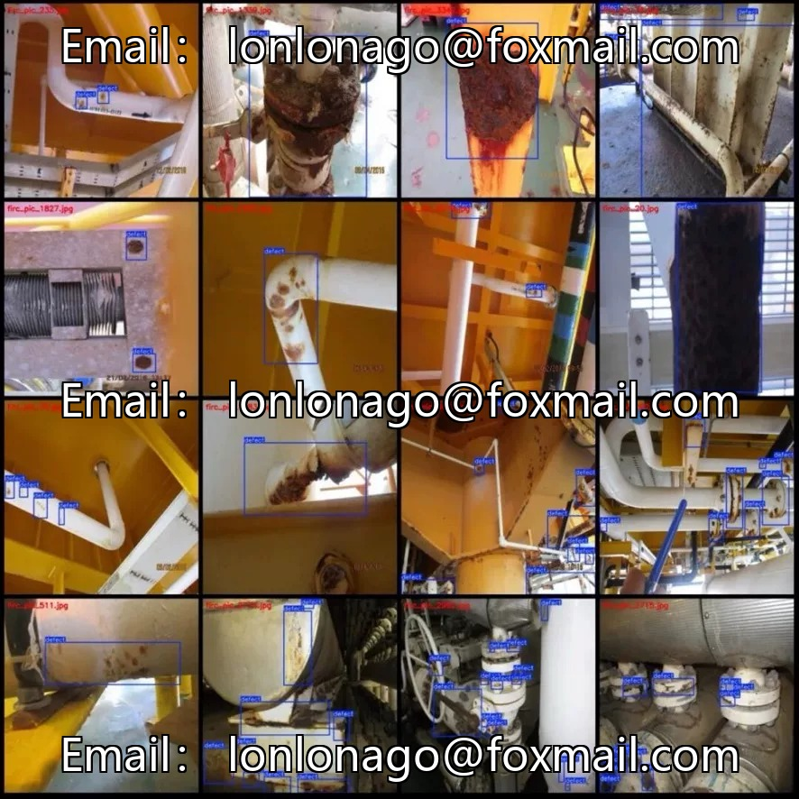
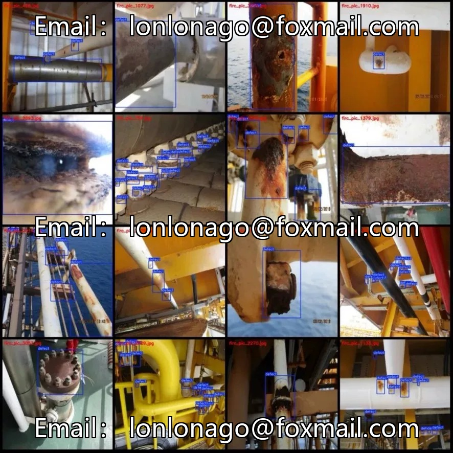

# Stainless Steel Pipeline Corrosion Detection Dataset | 3344 images, single-category, extremely high frame density

## Body

Stainless Steel Pipeline Corrosion Detection Dataset | 3344 images, single-category, extremely high frame density

3344 images of 640×640 resolution, single-category "defect" defect, total annotated bounding boxes 20932, an average of 6.3 per image. The defects are diverse in shape, including pinpoint rust spots, sheet corrosion areas, and rust stripes along welds, with a high density of annotations suitable for industrial defect detection scenarios.

Scene Location: Stainless steel conveying pipelines, rust and corrosion detection on iron pipes. Key monitoring targets in industries such as chemicals, food, energy, etc. Early corrosion is difficult to detect, making the model training friendly.

Data characteristics: Each image is annotated, with a single-category "Do you have defects/Defect localization". Suitable for use as an anomaly detection module in pipeline inspection systems. On-site scenario: Regular inspection of industrial pipelines, health monitoring of chemical plant pipelines, and surface inspection of pressurized equipment. The "Pipeline Leak Detection" and "Pipeline Defect Classification" previously posted belong to different stages of the same industrial chain.

Virtual materials, once sold, are non-refundable.
Interested friends, click "I want" to proceed.

## Images

## Payment

Here is a pay link on Stripe ( https://buy.stripe.com/3cs8yP7sY87d0vu9AB ). Please contact me lonlonago@foxmail.com after funding $89, and I will send you a complete data files , thank you!

